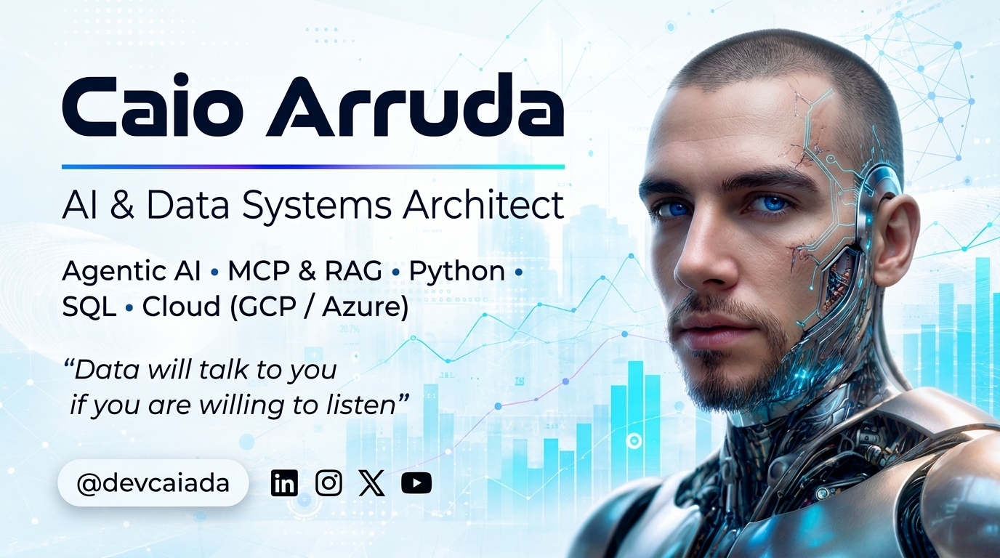
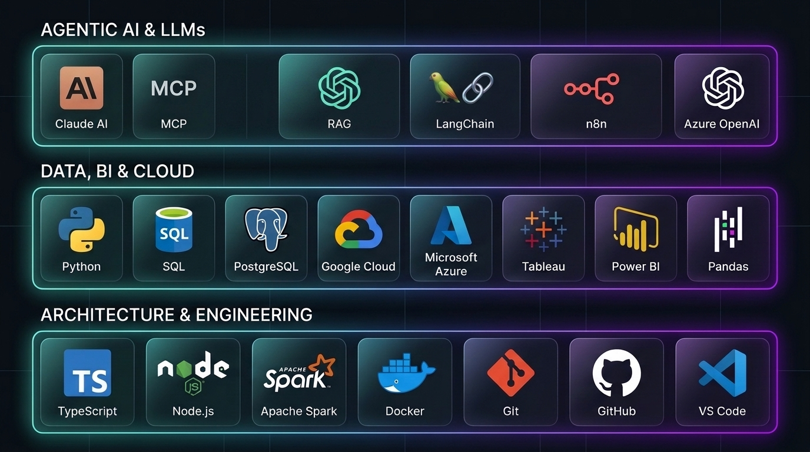

  

<h3 align="center">
  AI & Data Systems Architect | Agentic AI (MCP · RAG · LLM Orchestration)
</h3>

  <i>"I turn data into decisions — combining a data culture with cutting-edge AI & Cloud Architecture."</i>

  
  
  
  

 

  
  

 

## &nbsp;My Stack 

  

 

## &nbsp;About Me 

-  Hello there! I'm **Caio Arruda**, an **AI & Data Systems Architect** with **10+ years of experience** in technology, focused on **Analytics, BI, Cloud, and Artificial Intelligence**.
-  At **Skander Capital**, I work at the intersection of **Data, Finance, and AI** — managing investment portfolio analytics pipelines (**Python, SQL, Tableau**) and architecting the company's **Agentic AI operational core**.
-  My **Agentic AI architecture** enables natural-language operations across data, client, and portfolio management via **Claude AI**, integrating **MCP (Model Context Protocol)**, **RAG**, and workflow orchestration via **n8n** on **PostgreSQL (GCP)**.
-  **2nd Place Winner** at the **Microsoft Innovation Challenge Hackathon** (among 300+ global participants and 70 competing projects) with **Connection.ai**.
-  **Academic Background:** Postgraduate in **Software Architecture, Data Science & Cybersecurity** (*PUC-Campinas / PUCPR Dual Degree*), Specialization in **Finance** (*COPPEAD UFRJ*), and degrees in **Systems Analysis & Development** and **Business Administration**.
-  **It's dangerous to go alone!** **[Follow me on GitHub](https://github.com/devcaiada)** & **[Connect on LinkedIn](https://www.linkedin.com/in/devcaiada/)**.

 

## &nbsp;Certifications & Credentials 

  
  
  
  
  

 

##  &nbsp;Featured Projects & Architecture

<table>
  <thead>
    <tr>
      <th colspan="2" width="2000">&nbsp;</th>
    </tr>
  </thead>
  <tbody>
    <tr>
      <td align="center" valign="top" width="90"> 
        
      </td>
      <td valign="top">
        <h3>DevBible 🛡️</h3>
        
The ultimate open-source development checklist, CLI security auditor &amp; AI agent skills guide (Claude Code, MCP &amp; modern AI workflows) for builders and vibecoders.

        
      </td>
    </tr>
    <tr>
      <td align="center" valign="top" width="90"> 
        
      </td>
      <td valign="top">
        <h3>Connection.ai 🏆</h3>
        
<b>2nd Place Winner – Microsoft Innovation Challenge Hackathon</b> (among 300+ global participants &amp; 70 competing projects). AI-powered platform built on Azure &amp; TypeScript to optimize communication and inclusive matching between companies and talent.

        
      </td>
    </tr>
    <tr>
      <td align="center" valign="top" width="90"> 
        
      </td>
      <td valign="top">
        <h3>Vulnerability Detection Architectures 🔒</h3>
        
AI-driven cybersecurity &amp; architecture analysis agent written in Python that inspects software architecture diagrams and specifications to identify security vulnerabilities and mitigation strategies.

        
      </td>
    </tr>
    <tr>
      <td align="center" valign="top" width="90"> 
        
      </td>
      <td valign="top">
        <h3>Automated Unit Test Agent (LangChain &amp; Azure OpenAI) 🧪</h3>
        
LLM orchestration pipeline combining Python, LangChain, and Azure ChatGPT to automatically generate, validate, and refine unit tests for software projects.

        
      </td>
    </tr>
    <tr>
      <td align="center" valign="top" width="90"> 
        
      </td>
      <td valign="top">
        <h3>Azure Custom RAG Chatbot &amp; Cloud Data Pipelines ☁️</h3>
        
Document-grounded conversational AI built with RAG on Microsoft Azure, alongside automated cloud data engineering &amp; cost-monitoring workflows (<a href="https://github.com/devcaiada/data-factor-monitor-price">Azure Data Factory Monitor</a>).

        
      </td>
    </tr>
  </tbody>
</table>

 

## &nbsp;Contact Me 

  

    
    
    
    
  

 

  
Credits 

  - GitHub Stats by <a href="https://github.com/anuraghazra/github-readme-stats">anuraghazra</a> 
  - GitHub Badges by <a href="https://github.com/Ileriayo/markdown-badges?tab=readme-ov-file#table-of-contents">Ileriayo</a> 
  - GitHub Animated Emojis by <a href="https://github.com/Tarikul-Islam-Anik/Animated-Fluent-Emojis">Tarikul-Islam-Anik</a> 
  - My greatest influence and teacher <a href="https://github.com/felipeAguiarCode">felipeAguiarCode</a>

